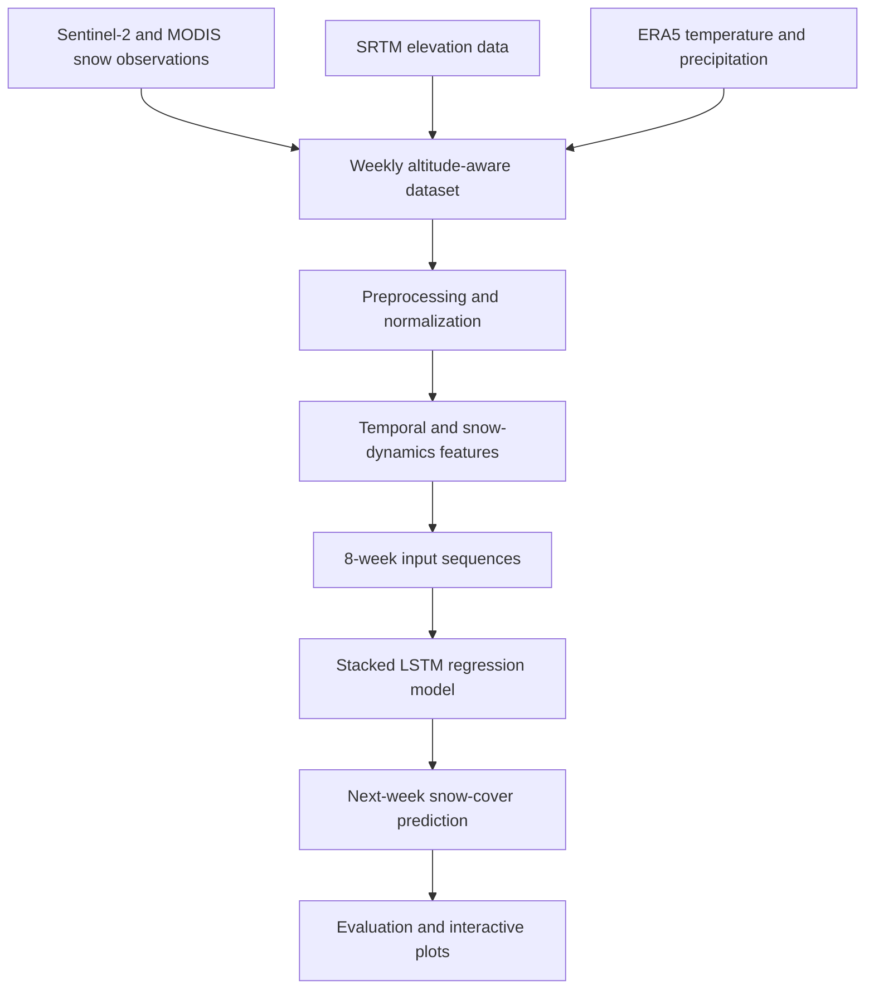

# ❄️ SnowFLOWS

### Spatio-Temporal Snow Cover Forecasting in Lebanon Using Satellite Imagery and Deep Learning

**Tech stack:** Python · TensorFlow/Keras · scikit-learn · NumPy · pandas · Google Earth Engine · Plotly

## Overview

Snow cover in Lebanon's mountains influences water availability, agriculture, and seasonal environmental conditions. **SnowFLOWS** investigates whether satellite-derived snow observations and meteorological variables can be used to forecast snow cover one week ahead.

The project combines remote-sensing data extraction, altitude-aware time-series preprocessing, feature engineering, and a stacked Long Short-Term Memory (LSTM) neural network. The current implementation focuses on **weekly snow-cover forecasting above 1,200 m**, rather than pixel-level future snow-map generation.

## Project Pipeline



## Data and Preprocessing

**Data sources**

- **Sentinel-2:** Satellite imagery used to estimate snow-covered area.
- **MODIS:** Additional snow-cover observations for temporal comparison.
- **SRTM DEM:** Elevation information used to analyze snow across altitude bands.
- **ERA5:** Temperature and precipitation data used as model inputs.
- **Google Earth Engine:** Satellite-data filtering, snow detection, and extraction.

**Snow detection:** The remote-sensing workflow uses the Normalized Difference Snow Index (NDSI), with cloud masking and a threshold-based snow classification approach. Snow-cover estimates are aggregated into weekly observations and studied across altitude bands (above 1,200 m, 1,200–1,800 m, and above 1,800 m).

**Feature engineering:** The sequence-generation script constructs 20 input features, including seasonal sine/cosine encoding, lagged snow observations, snow-change and gradient features, satellite snow signals, and meteorological variables. Each prediction uses **8 consecutive weeks** of inputs.

## Model Architecture

The main training implementation is in [`train_lstm.py`](train_lstm.py).

```text
Input sequence (8 weeks × 20 features)
          ↓
LSTM (96 units, return_sequences=True)
          ↓
Dropout (0.15)
          ↓
LSTM (64 units)
          ↓
Dropout (0.15)
          ↓
Dense (32, ReLU)
          ↓
Dense (16, ReLU)
          ↓
Dense (1): next-week forecast
```

**Training configuration**

| Component                         | Implementation                  |
| --------------------------------- | ------------------------------- |
| Framework                         | TensorFlow / Keras              |
| Optimizer                         | Adam (learning rate: 0.0003)    |
| Loss                              | Custom peak-weighted Huber loss |
| Metrics                           | MAE and RMSE                    |
| Batch size                        | 8                               |
| Maximum training epochs in script | 150                             |
| Learning-rate adjustment          | ReduceLROnPlateau               |
| Temporal ordering                 | Training with `shuffle=False`   |

The custom loss places greater weight on high-snow observations to address the tendency of regression models to smooth seasonal peaks. The training script also compares performance against a persistence-style baseline.

## Repository Structure

```text
SnowFlows/
├── GEE/                             # Google Earth Engine scripts
├── MODIS-25/                        # MODIS-related materials
├── data/                            # Supporting datasets
├── evaluation/                      # Evaluation materials
├── Altitude Comparison code and graph/
├── create_sequences.py             # Feature engineering and sequence generation
├── create_sequences_altitudes.py   # Altitude-focused sequence generation
├── train_lstm.py                   # Primary LSTM training and evaluation
├── train_lstm_altitudes.py         # Altitude-focused LSTM experiment
├── splitting_data.py               # Data splitting
├── zscore_transformation.py        # Normalization workflow
├── target_column_added.py         # Forecast-target preparation
├── weekly_snow_model_ready_with_target.csv
├── X_train.npy / X_val.npy / X_test.npy
├── y_train.npy / y_val.npy / y_test.npy
├── loss_plot.html                   # Interactive training-loss plot
├── mae_plot.html                    # Interactive MAE plot
├── full_timeline_predictions.html   # Forecast timeline
├── full_timeline_predictions_altitudes.html
└── README.md
```

Additional scripts and intermediate datasets are available at the repository root.

## Getting Started

### 1. Get the project

```bash
git clone https://github.com/noursag/SnowFlows.git
cd SnowFlows
```

Alternatively, use GitHub's **Code → Download ZIP** option if cloning is unavailable.

### 2. Install dependencies

Create a virtual environment and install the libraries used by the scripts (TensorFlow, NumPy, pandas, scikit-learn, and Plotly). A pinned dependency file is not yet provided in this repository.

### 3. Train and evaluate using existing arrays

The repository includes pre-generated NumPy arrays (`X_train.npy`, `X_val.npy`, `X_test.npy`, and matching `y_*.npy` files). From the repository root, run:

```bash
python train_lstm.py
```

This trains a model using the saved arrays, prints evaluation metrics, and writes interactive HTML plots. Results may differ between runs because random seeds and environment versions are not fully pinned.

### 4. Regenerate sequences (optional)

The source dataset is `weekly_snow_model_ready_with_target.csv`. Before running `create_sequences.py`, replace its existing machine-specific `file_path` with a valid path to that CSV in your environment. Then execute:

```bash
python create_sequences.py
```

This generates the NumPy training, validation, and test arrays. Run preprocessing scripts only after checking their input paths and required source files.

## Evaluation and Visualizations

The project evaluates forecasts using **mean absolute error (MAE)** and **root mean squared error (RMSE)** and includes a persistence-baseline comparison.

Generated interactive artifacts available in the repository include:

- [`loss_plot.html`](loss_plot.html) — training and validation loss curves
- [`mae_plot.html`](mae_plot.html) — training and validation MAE curves
- [`full_timeline_predictions.html`](full_timeline_predictions.html) — observed and predicted values over time
- [`full_timeline_predictions_altitudes.html`](full_timeline_predictions_altitudes.html) — altitude-focused timeline
- [`sequence_comparison.html`](sequence_comparison.html) — sequence comparison visualization

**Performance reporting:** The exact final test metrics and comparison conditions should be taken from a verified run or saved experiment record. Numerical improvements are intentionally not asserted here until they are documented with their baseline, dataset split, and units.

## Limitations and Future Work

- Cloud contamination and irregular satellite coverage can affect snow estimates.
- Weekly altitude-level forecasting is not the same as pixel-level snow segmentation or spatial map forecasting.
- Some preprocessing scripts contain machine-specific paths and need environment-independent configuration.
- Evaluation should be repeated with pinned dependencies and saved random seeds for reproducibility.
- Future extensions could include additional snow-detection sources, terrain features, multi-horizon forecasts, and spatial deep-learning architectures.

## Team and Supervision

**Project team:** Nour El Saghir · Carla Youness · Reina Taher · Ali Mansour · Hassan Dakhlallah

**Supervisors:** Dr. Laurent Drapeau · Dr. Youssef El Bakouny

**Institution:** École Supérieure d'Ingénieurs de Beyrouth (ESIB), Université Saint-Joseph de Beyrouth

## Acknowledgements

Data and supporting platforms: Copernicus Sentinel-2, NASA MODIS, USGS SRTM, ECMWF ERA5, and Google Earth Engine.
