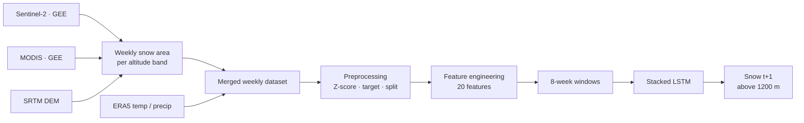

<div align="center">

# ❄️ SnowFLOWS

**Spatio-temporal modelling and forecasting of snow cover in Lebanon using satellite imagery**


Multidisciplinary Project · ESIB – Université Saint-Joseph de Beyrouth

</div>

---

## Table of contents

- [Overview](#overview)
- [Pipeline](#pipeline)
- [Repository structure](#repository-structure)
- [Data](#data)
- [Modelling](#modelling)
- [Getting started](#getting-started)
- [Results](#results)
- [Roadmap](#roadmap)
- [Team](#team)
- [License](#license)
- [Acknowledgements](#acknowledgements)

## Overview

Snow cover in the Lebanese mountains drives groundwater recharge, river discharge, agriculture and tourism, yet it varies strongly from year to year. SnowFLOWS is a pipeline that:

1. Extracts **weekly snow-covered area** from Sentinel-2 and MODIS (2016–2025) using the NDSI index in Google Earth Engine.
2. Splits the snow signal by **altitude band** using the SRTM DEM.
3. Adds **ERA5 temperature and precipitation**.
4. Trains a **stacked LSTM** to forecast next-week snow surface above 1200 m.

The longer-term goal is a spatio-temporal forecasting framework (ConvLSTM, UNet-3D, TimeSformer, generative models) with +3 / +10 / +30 day horizons and a 3D visualization. The current code covers the weekly, altitude-resolved time-series stage.

## Pipeline



## Repository structure

Suggested layout (adjust paths if you keep everything at the root):

```
snowflows/
├── data/
│   ├── raw/
│   │   └── Sentinel2_and_Modis_Weekly_Snow_By_Altitude_20162025_1.csv
│   └── processed/
│       └── weekly_snow_model_ready_with_target.csv
├── gee/
│   ├── Sentinel2_code.js        # weekly Sentinel-2 snow area (renamed from .txt)
│   └── NDSI.js                  # NDSI visualization variant (renamed from .txt)
├── src/
│   ├── create_sequences.py      # 8-week sliding windows
│   └── train_lstm2.py           # LSTM training and evaluation
├── reports/
│   ├── MDP_report_1_3.pdf
│   ├── MDP_report_2.pdf
│   └── MDP_SNOWFLOWS_report_3.pdf
├── requirements.txt
├── .gitignore
├── LICENSE
└── README.md
```

| Item                              | Description                                                                                                 |
| --------------------------------- | ----------------------------------------------------------------------------------------------------------- |
| `gee/Sentinel2_code.js`           | Sentinel-2 SR weekly snow area for Lebanon (Oct 2021 – Jun 2025), SCL cloud mask, NDSI > 0.4, CSV export.   |
| `gee/NDSI.js`                     | Variant with NDSI map layers (RGB, NDSI, snow mask, winter mean) using `S2_SR_HARMONIZED`.                  |
| `data/raw/…20162025_1.csv`        | Raw weekly dataset: Sentinel-2 and MODIS snow (km²), temperature (°C), precipitation (mm) by altitude band. |
| `data/processed/…with_target.csv` | Model-ready dataset: Z-scored features, `split` label, next-week target. 452 rows.                          |
| `src/create_sequences.py`         | Builds the `(samples, 8, 20)` tensors.                                                                      |
| `src/train_lstm2.py`              | Defines, trains and evaluates the LSTM.                                                                     |
| `reports/`                        | Project reports 1–3.                                                                                        |

## Data

### Sources

| Source                              | Use                         | Resolution           |
| ----------------------------------- | --------------------------- | -------------------- |
| Sentinel-2 L2A (`COPERNICUS/S2_SR`) | Snow detection              | 10 m, ~5-day revisit |
| MODIS snow cover                    | Snow detection, cross-check | ~500 m, daily        |
| SRTM DEM (`USGS/SRTMGL1_003`)       | Altitude bands              | 30 m                 |
| ERA5 reanalysis                     | Temperature, precipitation  | –                    |
| FAO GAUL 2015 level 0               | Lebanon boundary            | –                    |

### Altitude bands

Every variable is computed for: **> 1200 m**, **1200 – 1800 m**, and **> 1800 m**.

### Snow detection

1. Filter Sentinel-2 images over Lebanon by date and cloud percentage.
2. Mask clouds, shadows and defective pixels with the Scene Classification Layer (SCL).
3. Compute `NDSI = (B3 − B11) / (B3 + B11)` and classify snow where **NDSI > 0.4**.
4. Average the binary mask per week, multiply by pixel area, and sum to km².

### Known limitations

- Residual cloud contamination remains after SCL masking.
- Sentinel-2 coverage is sparse in 2016–2017.
- Earth Engine quotas required splitting the extraction into several periods, merged afterwards.
- The two GEE scripts use different cloud-masking rules and cloud-percentage thresholds (70% vs 50%); use one consistently when re-running.

### Model-ready dataset schema

| Column(s)                           | Description                                                         |
| ----------------------------------- | ------------------------------------------------------------------- |
| `year`, `week_of_year`              | Temporal indicators                                                 |
| `split`                             | `train` / `validation` / `test` (chronological, 316 / 68 / 68 rows) |
| `s2_snow_*_smoothed_zscore` (×3)    | Sentinel-2 snow area per altitude band                              |
| `modis_snow_*_smoothed_zscore` (×3) | MODIS snow area per altitude band                                   |
| `temp_*_smoothed_zscore` (×3)       | ERA5 temperature per altitude band                                  |
| `precip_*_smoothed_zscore` (×3)     | ERA5 precipitation per altitude band                                |
| `target_snow_next_week`             | Sentinel-2 snow area above 1200 m at week _t+1_                     |

## Modelling

**Task:** one-week-ahead regression of Sentinel-2 snow surface above 1200 m.

**Input:** 8 consecutive weeks × 20 features. Shapes: train `(307, 8, 20)`, validation `(68, 8, 20)`, test `(67, 8, 20)`.

| Feature group               | Variables                            |
| --------------------------- | ------------------------------------ |
| Seasonal encoding           | `week_sin`, `week_cos`               |
| Persistence                 | `snow_last_week`, `snow_last_2weeks` |
| Change dynamics             | `snow_change_ratio`                  |
| Aggregate signal            | `snow_mean`                          |
| Derivatives                 | `snow_gradient`, `snow_acceleration` |
| Sentinel-2 / MODIS snow     | 3 altitude bands each                |
| Temperature / precipitation | 3 altitude bands each                |

**Architecture**

```
Input (8 × 20)
 → LSTM(96) → Dropout(0.15)
 → LSTM(64) → Dropout(0.15)
 → Dense(32) → Dense(16) → Dense(1)
```

**Training**

| Setting                 | Value                                                         |
| ----------------------- | ------------------------------------------------------------- |
| Optimizer               | Adam, lr = 3e-4                                               |
| Batch size / max epochs | 8 / 150                                                       |
| Shuffle                 | Off (preserves chronology)                                    |
| Loss                    | Peak-weighted Huber, δ = 1.0, weight = 1 + 1.5·max(0, y_true) |
| LR schedule             | `ReduceLROnPlateau` (factor 0.5, patience 6)                  |
| Early stopping          | patience 12, restore best weights                             |
| Metric                  | MAE                                                           |

**Baseline:** persistence forecast (`snow(t+1) ≈ snow(t)`).

**Design note:** configurations with the lowest MAE tended to smooth out and underestimate winter peaks. The peak-weighted Huber loss trades a slightly higher global MAE for better reproduction of seasonal maxima.

## Getting started

### Prerequisites

- A [Google Earth Engine](https://earthengine.google.com/) account
- Python 3.9+

```bash
git clone https://github.com/<your-username>/snowflows.git
cd snowflows
python -m venv .venv
source .venv/bin/activate        # Windows: .venv\Scripts\activate
pip install -r requirements.txt
```

### Run

1. **Extract snow data:** paste `gee/Sentinel2_code.js` into the [GEE Code Editor](https://code.earthengine.google.com/), set `start` / `end`, run, and export the CSV from the Tasks tab. Repeat per altitude band and for MODIS.
2. **Prepare the dataset:** merge snow, temperature and precipitation by week, split `week_start` into `year` and `week_of_year`, apply `StandardScaler`, add `target_snow_next_week` and the chronological `split` column.
3. **Build sequences:**
   ```bash
   python src/create_sequences.py
   ```
4. **Train and evaluate:**
   ```bash
   python src/train_lstm2.py
   ```

## Results

- Sentinel-2 and MODIS weekly series agree on seasonal behaviour (winter maxima, summer minima).
- Snow persistence increases with altitude: higher bands keep snow longer, lower bands melt earlier.
- The LSTM reproduces the main seasonal structure across train, validation and test periods.
- Test MAE: **TODO – add value and a prediction plot** (e.g. `docs/prediction_timeline.png`).

## Roadmap

- [ ] Add Sentinel-1 SAR for snow detection under cloud cover
- [ ] Add slope and aspect; evaluate by terrain
- [ ] Forecast horizons of +3, +10 and +30 days
- [ ] Compare ConvLSTM, UNet-3D, TimeSformer and generative models
- [ ] Add RMSE, IoU, Dice and per-altitude evaluation
- [ ] Interactive visualization with a 3D terrain snow overlay

## Team

Nour el Saghir · Carla Youness · Reina Taher · Ali Mansour · Hassan Dakhlallah

**Supervisors:** Dr. Laurent Drapeau · Dr. Youssef El Bakouny

École Supérieure d'Ingénieurs de Beyrouth (ESIB), Université Saint-Joseph de Beyrouth

## License

Distributed under the MIT License. See `LICENSE` for details.

## Acknowledgements

Copernicus Sentinel-2, NASA MODIS, USGS SRTM, ECMWF ERA5, FAO GAUL and Google Earth Engine.
